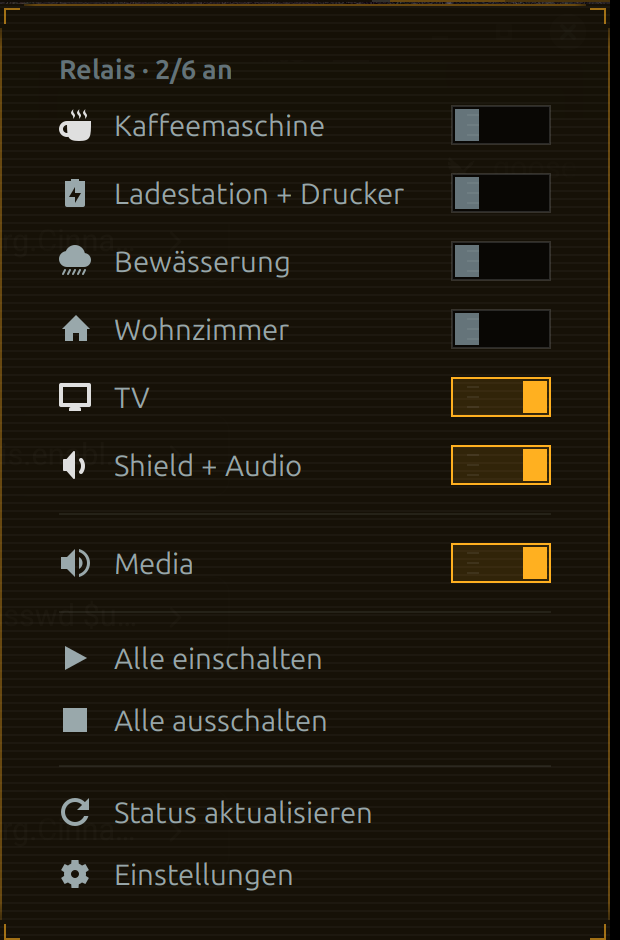

# Relay Switches — Cinnamon-Applet

Ersetzt die Nemo-Scripts (`drucker-on.sh`, `kafi-off.sh`, `media-on.sh` …) durch ein
Applet in der Leiste: ein Klick öffnet ein Menü mit Schaltern, die direkt das
HTTP-Relaisboard schalten — inklusive echtem Status vom Gerät.



Konfiguriert wird über den normalen Cinnamon-Dialog:


## Funktionen

* **Schalter mit echtem Status** – das Applet liest `GET /relay` (`{"on": true}`) und
  zeigt an/aus/offline, statt den Zustand zu raten.
* **Beliebig viele Schalter** – Name, Symbol, Host(s), Ein-/Aus-/Status-Pfad sind
  pro Eintrag konfigurierbar.
* **Mehrere Geräte pro Schalter** – Hosts mit Komma trennen (z. B. eine
  Steckdosenleiste auf zwei Boards). Alle werden gemeinsam geschaltet.
* **Gruppen** – mehrere Schalter zu einem weiteren Switch zusammenfassen
  (z. B. `Feierabend` = Drucker + TV aus).
* **Panel-Anzeige** – Symbol, optional `2/6` oder die Namen der aktiven Schalter.
  Ein zweites Symbol für „etwas ist an" ist einstellbar.
* **Statusabfrage im Hintergrund** – Intervall einstellbar (0 = nur beim Öffnen).
* **Benachrichtigung**, wenn ein Gerät nicht antwortet.
* **Mittelklick** frei belegbar (Status aktualisieren, alles an/aus, Menü).
* **CLI `relayctl`** – dieselbe Konfiguration aus Nemo-Scripts, Hotkeys oder Terminal.

## Aktuelle Belegung

| Schalter | IP | Symbol |
| --- | --- | --- |
| Kaffeemaschine | 192.168.101.33 | Kaffeetasse |
| Ladestation + Drucker | 192.168.101.36 | Stecker |
| Bewässerung | 192.168.101.37 | Regenwolke |
| Wohnzimmer | 192.168.101.32 | Haus |
| TV | 192.168.101.31 | Bildschirm |
| Shield + Audio | 192.168.101.30 | Lautsprecher |
| **Gruppe Media** | – | Shield + Audio + TV |

Diese Werte sind gleichzeitig die Defaults im Schema — eine Neuinstallation (auch
für andere Benutzer) startet also mit genau dieser Belegung.

## Installation

```bash
cd ~/git/tools/applets/relay-switches@ravel
./install.sh                 # nur installieren
./install.sh --panel --cli   # + in die obere Leiste hängen + relayctl installieren
```

Danach Cinnamon neu laden (`Alt+F2` → `r` → Enter) und das Applet über
*Rechtsklick auf die Leiste → Applets* hinzufügen, falls `--panel` nicht genutzt wurde.

Für einen anderen Benutzer (z. B. ein zweites Konto auf demselben Rechner):

```bash
sudo ./install.sh --for raveloffice --panel --cli --settings
```

Das kopiert die Dateien mit korrekten Besitzrechten nach
`/home/raveloffice/.local/share/cinnamon/...`, hängt das Applet über die
D-Bus-Sitzung dieses Benutzers in seine Leiste, installiert `relayctl` dort und
übernimmt mit `--settings` die eigenen Schalter/Gruppen/Einstellungen
(Vorlage: `~/.config/cinnamon/spices/relay-switches@ravel/`).

`--settings` baut die Zieldatei gegen das installierte Schema neu auf (nur Werte
werden übernommen, Layout/Spalten kommen aus dem Schema, inklusive passender
`__md5__`), eine vorhandene Datei wird als `*.json.bak` gesichert. Damit die
laufende Sitzung die Werte übernimmt, danach einmal Cinnamon neu laden:

```bash
sudo ./install.sh --for raveloffice --reload
```

Läuft für diesen Benutzer gerade kein Cinnamon, wird nur installiert — dann das
Applet in dieser Sitzung über *Rechtsklick auf die Leiste → Applets* hinzufügen.

Zum Deinstallieren:

```bash
rm -rf ~/.local/share/cinnamon/applets/relay-switches@ravel \
       ~/.config/cinnamon/spices/relay-switches@ravel \
       ~/.local/bin/relayctl
```

## Konfiguration

Rechtsklick auf das Applet → **Konfigurieren** (oder Zahnrad im Menü).

### Seite „Schalter"

| Spalte | Bedeutung |
| --- | --- |
| Name | Anzeigename, muss eindeutig sein (Gruppen verweisen darauf) |
| Symbol | Icon-Name oder Datei (z. B. `printer`, `audio-speakers`, `ac-adapter-symbolic`) |
| Hosts / IPs | `192.168.101.33` oder `http://board.local:8080`; mehrere mit Komma |
| Ein-Pfad | Standard `/relay?state=1` |
| Aus-Pfad | Standard `/relay?state=0` |
| Status-Pfad | Standard `/relay` |

Die Reihenfolge in der Liste ist die Reihenfolge im Menü. Erklärungen zu Hosts und
Pfaden stehen als Tooltip an der Liste (Maus über „Schalter" halten); der
Status-Pfad ist in der Tabelle rechts zu sehen (Liste ggf. breiter ziehen).

> Der Dialog hat eine feste Startgröße (800×600) und scrollt nicht — deshalb sind
> die Liste und die Hilfetexte bewusst kompakt gehalten. Am Fensterrand ziehen
> vergrößert die Ansicht, die Spalten selbst sind ebenfalls ziehbar.

Ein neuer Schalter ist also nur ein neuer Eintrag — z. B. „Werkstatt" mit
`192.168.101.40` und den Standard-Pfaden. Fertig.

### Seite „Gruppen"

Ein Gruppen-Eintrag erscheint als zusätzlicher Switch und legt alle Mitglieder
gemeinsam um:

| Name | Symbol | Schalter (Komma) |
| --- | --- | --- |
| Feierabend | system-shutdown | Drucker, TV |

Der Gruppen-Switch ist „an", wenn **alle** Mitglieder an sind.

### Seite „Panel"

* **Text neben dem Symbol**: nichts, `2/4` oder die Namen der aktiven Schalter
  (erscheint nur, wenn mindestens ein Schalter an ist).
* **Symbol**: Standard `network-server-symbolic` — symbolische Icons passen sich
  der Leistenfarbe an.
* **Symbol, wenn etwas an ist**: z. B. ein farbiges Amber-Icon, damit der Zustand
  sofort ins Auge fällt (leer = gleiches Symbol).

### Seite „Verhalten"

* Statusabfrage alle *n* Sekunden (0 = aus, Abfrage dann nur beim Öffnen des Menüs).
* Benachrichtigung bei nicht erreichbaren Geräten.
* Zeitlimit pro HTTP-Anfrage.

## Status-Erkennung

Das Applet versteht als Antwort auf den Status-Pfad:

```json
{"on": true}
```

sowie `true` / `false`, `1` / `0`, `on` / `off`. Antwortet ein Board nicht oder
liefert etwas Unbekanntes, gilt der Schalter als **offline** (grauer Hinweis im Menü,
Zähler in der Kopfzeile) — geschaltet werden kann er trotzdem, dann kommt eine
Benachrichtigung, wenn das Gerät nicht antwortet.

## CLI `relayctl`

Liest die vom Applet exportierte Konfiguration
(`~/.config/cinnamon/spices/relay-switches@ravel/switches.json`), braucht also
kein Cinnamon und keine zusätzlichen Abhängigkeiten:

```bash
relayctl list
relayctl status
relayctl on Kaffeemaschine
relayctl off Media
relayctl toggle Drucker
relayctl all-off
```

Damit lassen sich die alten Nemo-Scripts ersetzen, z. B. `~/.local/share/nemo/scripts/kafi-on.sh`:

```bash
#!/bin/sh
exec relayctl on Kaffeemaschine
```

Oder als Hotkey in Cinnamon: `relayctl toggle Media`.

## Technisches

* HTTP über `curl` (async, ohne Shell) — dieselbe Semantik wie die alten Scripts.
* Status wird nach jedem Schaltvorgang erneut gelesen, nicht optimistisch gesetzt.
* Konfiguration liegt in Cinnamon-Settings
  (`~/.config/cinnamon/spices/relay-switches@ravel/`), nichts wird doppelt gepflegt.
* Läuft ab Cinnamon 5.8, entwickelt und getestet auf Cinnamon 6.6.

## Bekannte Stolpersteine

* **Applet reagiert nicht nach Änderungen im Konfigurationsdialog**: Cinnamon lädt
  Änderungen über D-Bus; nach `install.sh` einmal Cinnamon neu laden.
* **Schalter „offline", obwohl erreichbar**: Status-Pfad prüfen
  (`curl http://IP/relay`) und ggf. `Status-Pfad` anpassen.
* **Symbol wird nicht angezeigt**: bei symbolischen Icons `-symbolic` im Namen
  verwenden, sonst wird das Icon in Originalfarbe gezeichnet.
